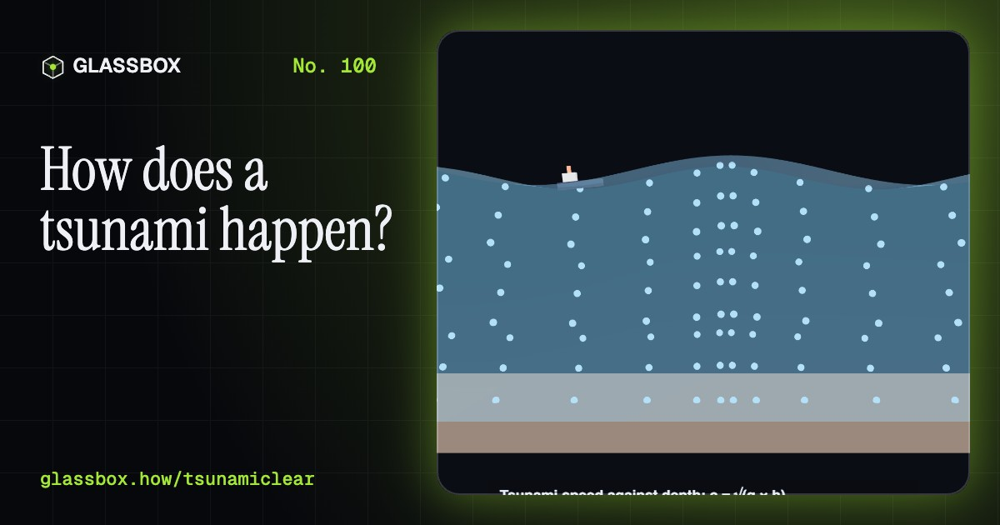
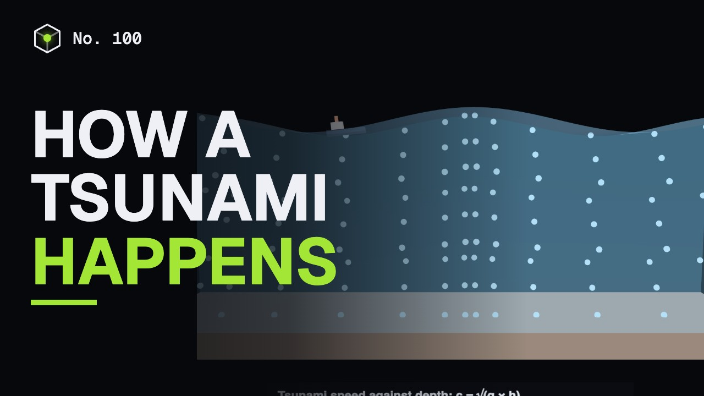
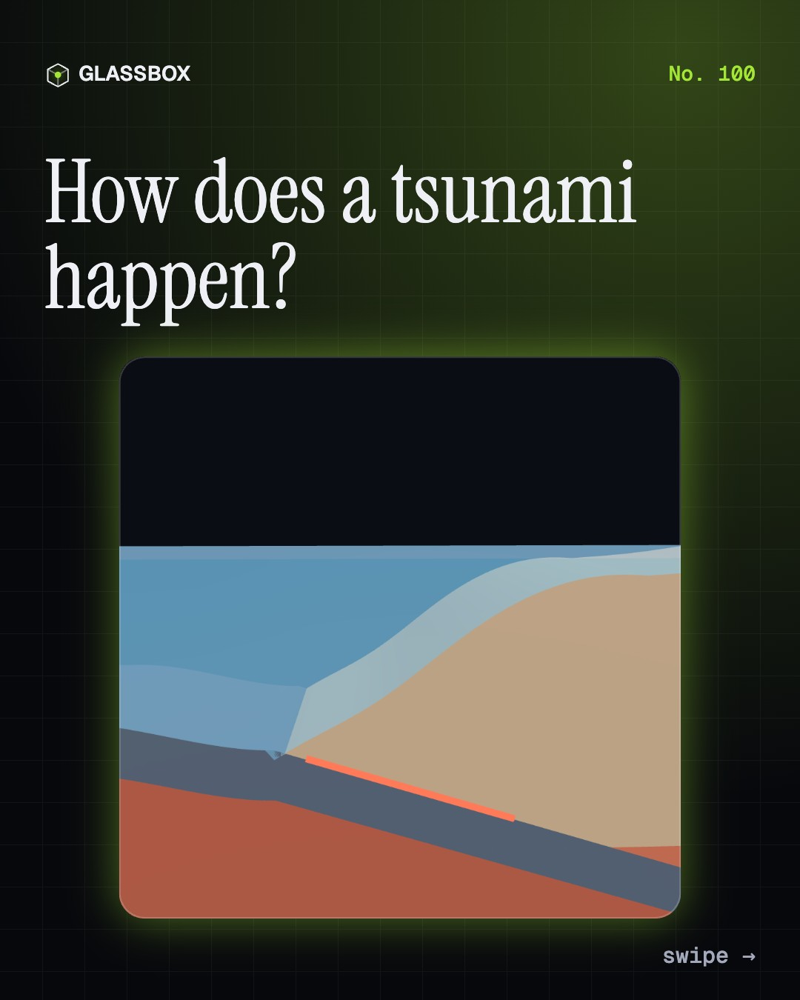
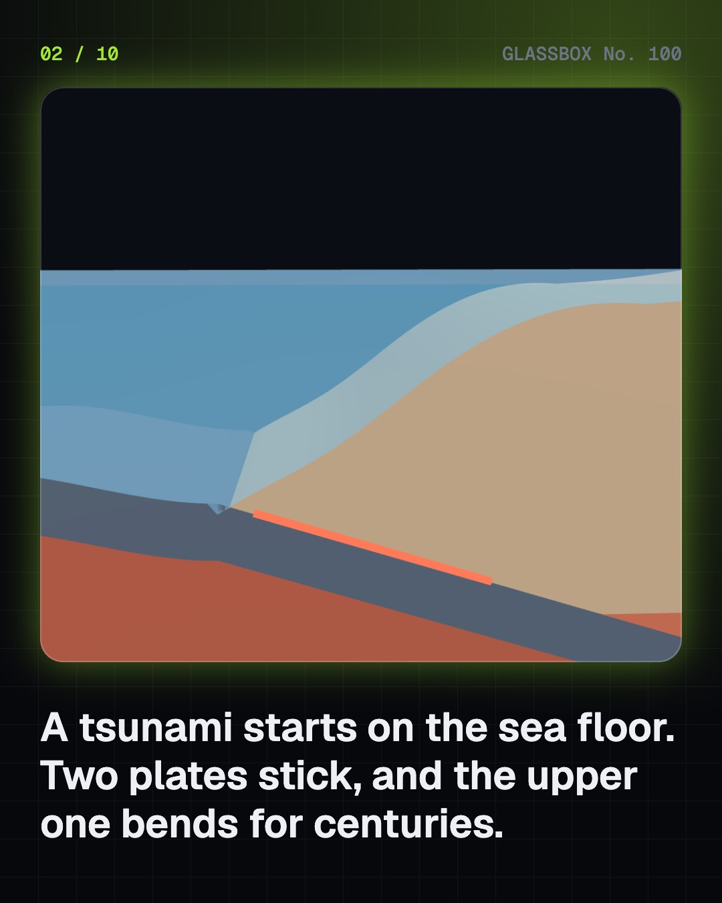
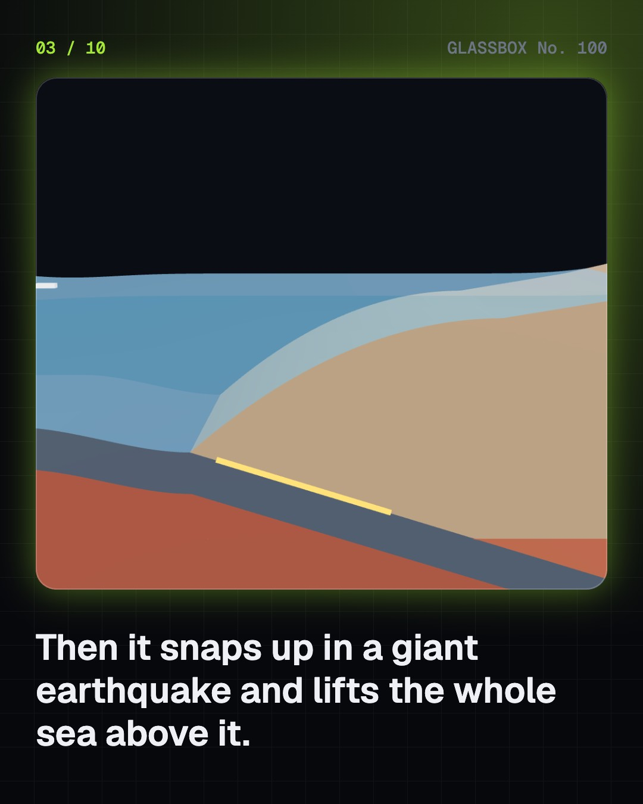
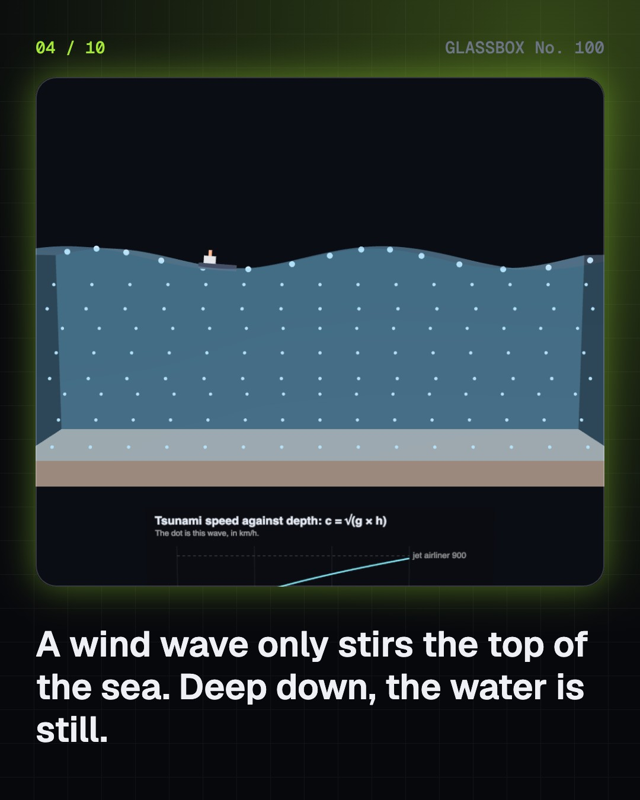

<!-- glassbox:start -->
<!-- Generated from glassbox.json by the Glassbox hub (npm run readme -- tsunamiclear). Edit glassbox.json, not this block. -->
<p align="center"><a href="https://glassbox.how/e/tsunamiclear/"></a></p>

<h1 align="center">TsunamiClear</h1>

<p align="center"><b>How does a tsunami happen?</b><br>A tsunami is not a big wave from the wind and it has nothing to do with the tide. The sea floor jumps, the whole ocean moves, and a low, fast wave crosses it at the speed of a jet. Break the fault yourself, follow the 2004 wave across the Indian Ocean, watch it grow at the shore, and learn the three signs that mean go to high ground.</p>

<p align="center"><a href="https://glassbox.how/tsunamiclear/"><b>▶ Play with it</b></a> &nbsp;·&nbsp; <a href="https://glassbox.how/e/tsunamiclear/">Read the 60-second explainer</a> &nbsp;·&nbsp; <a href="https://glassbox.how/tsunamiclear/glassbox/reel.mp4">Watch the 40-second video</a></p>

<p align="center">
  <a href="https://glassbox.how/e/tsunamiclear/"></a>
  <a href="https://glassbox.how/e/tsunamiclear/"></a>
  <a href="LICENSE"></a>
  <a href="LICENSE-CONTENT.md"></a>
  <a href="#privacy"></a>
</p>

## In 60 seconds

1. **The sea floor moves.** Off Sumatra one plate slides under another at a few centimetres a year. The edges stick and the upper plate bends for centuries, then snaps up in a megathrust earthquake. In 2004 the fault broke along about 1,300 km and lifted the sea floor by several metres, and all the water above it. Landslides and volcanoes can do the same on a smaller scale.
2. **A wave that moves the whole ocean.** A wind wave stirs only the top of the sea. A tsunami is hundreds of kilometres long, so the whole depth moves and its speed depends only on depth: c = √(g × h). In 4,000 m that is 198 m/s, about 713 km/h. Out there it is under a metre high and a ship would not notice it.
3. **Across the ocean in hours.** On 26 December 2004 the wave reached Aceh and the Nicobar Islands within about 15 to 30 minutes, Sri Lanka and Tamil Nadu after about 2 hours (2 h 36 min at Chennai's tide gauge) and Somalia after about 7 hours. Fronts bend towards shallow water and wrap around islands.
4. **It grows at the shore.** In shallow water the wave slows and bunches up. Green's law says its height grows as depth to the power −¼: about 4.5 times from 4,000 m to 10 m. It arrives as a fast-rising flood, in several waves over hours, and the first is often not the largest. If a trough comes first the sea pulls back: a warning.
5. **Warning systems.** Earthquake waves travel about 40 times faster than the tsunami. Seismometers size the quake, sea-bed pressure recorders confirm the wave and tide gauges measure it. India's Tsunami Early Warning Centre at INCOIS, Hyderabad, running since 2007, sends a first bulletin in about 10 minutes. In 2004 the Indian Ocean had no such system.
6. **2004, and what to do.** About 2.3 lakh people died in 14 countries, more than 10,000 of them in India. People who knew the signs lived: Simeulue's islanders, the Moken, a ten-year-old on a Phuket beach. A strong or long quake at the coast, the sea pulling back, or a roar from the sea means go to high ground at once and stay there for hours. Emergency 112, NDMA 1078.

## Words worth knowing

| Term | Meaning |
|---|---|
| **Tsunami** | A series of very long waves made when a large volume of sea is suddenly moved, usually by an undersea earthquake. |
| **Subduction zone** | Where one plate of the Earth's crust slides under another. Most great tsunami-making earthquakes happen here. |
| **Shallow-water wave** | A wave much longer than the water is deep. Its speed is √(g × h) and the whole depth moves. |
| **Shoaling** | A wave slowing and growing taller as the water gets shallower. |
| **Green's law** | Wave height grows as depth to the power −¼, so long as the wave does not break. |
| **Drawback** | The sea draining away from the shore when a tsunami's trough arrives first. A natural warning. |
| **Storm surge** | Sea piled up against a coast by a cyclone's wind and low pressure. It is not a tsunami. |
| **Bottom pressure recorder** | A sea-bed sensor that detects a passing tsunami from the tiny rise in water pressure. |
| **INCOIS** | Indian National Centre for Ocean Information Services, Hyderabad, home of India's tsunami warning centre. |

## A short history

**From a Greek historian's guess to sensors on the sea bed: how people learned what a tsunami is, and how to get out of its way.**

- **1755** · Lisbon: quake, wave and fire (The people of Lisbon; the Marquis of Pombal, Lisbon)
- **1883** · Krakatoa
- **1945** · The Makran tsunami reaches Mumbai
- **1946** · The Aleutian tsunami hits Hawaii
- **1949** · The first tsunami warning centre (US Coast and Geodetic Survey, Ewa Beach, Hawaii)
- **1960** · Chile: the largest earthquake recorded
- **2004** · The Indian Ocean tsunami
- **2007** · India's tsunami warning centre opens (INCOIS, Ministry of Earth Sciences, Hyderabad)

The full story, with 22 moments, charts, people and 33 sources: [glassbox.how/e/tsunamiclear/history](https://glassbox.how/e/tsunamiclear/history/). The data lives in [`history.json`](history.json).

## Video and slides

Made with the Glassbox studio from this box's storyboard (`window.glassbox.director`). Free to reuse under CC BY 4.0.

<a href="https://glassbox.how/tsunamiclear/glassbox/video.mp4"></a>

<p><a href="glassbox/slide-1.jpg"></a> <a href="glassbox/slide-2.jpg"></a> <a href="glassbox/slide-3.jpg"></a> <a href="glassbox/slide-4.jpg"></a></p>

| File | What | Size |
|---|---|---|
| [`glassbox/reel.mp4`](https://glassbox.how/tsunamiclear/glassbox/reel.mp4) | Reel / Short, with captions and soundtrack | 1080×1920 |
| [`glassbox/video.mp4`](https://glassbox.how/tsunamiclear/glassbox/video.mp4) | YouTube video, with captions and soundtrack | 1920×1080 |
| `glassbox/slide-1…10.jpg` | Instagram carousel | 1080×1350 |
| `glassbox/thumb.jpg` | YouTube thumbnail | 1280×720 |
| `glassbox/cover.jpg` | Share card and repo social preview | 1200×630 |
| [`glassbox/history-reel.mp4`](https://glassbox.how/tsunamiclear/glassbox/history-reel.mp4) | “History in 10 moments” Reel / Short | 1080×1920 |
| `glassbox/history-slide-*.jpg` | History carousel | 1080×1350 |
| `glassbox/post.json` | Post copy and schedule used by the publish kit | |

## Privacy

This box has no accounts and no ads, and it ships its own fonts and libraries. When you run it yourself it sends nothing anywhere. On glassbox.how, the site's `/bar.js` also loads Glassbox's analytics: **Google Analytics** to count visits (it asks first in the EU, UK and Switzerland, and stays off when your browser sends Global Privacy Control or Do Not Track) and **ClickTrust** to detect bots.

It remembers a few things **in your own browser only**, and never sends them anywhere:

| Browser storage key | What it holds |
|---|---|
| `tsunamiclear.v1` | Which chapters you have opened, your best quiz scores, and sound on or off. |

Exactly what each one sees is at [glassbox.how/privacy](https://glassbox.how/privacy/).

## Licences

- **Code:** [MIT](LICENSE). Use it, change it, ship it.
- **Explanations, text, images and videos** (`glassbox.json`, `glassbox/`): [CC BY 4.0](LICENSE-CONTENT.md). Credit “Glassbox, glassbox.how/e/tsunamiclear”.
- **Third-party parts** keep their own licences: [three.js](https://threejs.org) (MIT), [Geist, Instrument Serif](https://openfontlicense.org) (SIL OFL 1.1).
- The Glassbox name and logo aren't covered by either licence. See the [terms](https://glassbox.how/terms/).

Found a mistake? [Open an issue](https://github.com/bdeeps/tsunamiclear/issues). Corrections happen in public.
<!-- glassbox:end -->

## Run it

It's plain HTML, CSS and JavaScript. No build step and no dependencies. Run locally, it contacts no other website.

```bash
python3 -m http.server 8000
```

Three.js and the fonts ship in `vendor/` and `fonts/`, so it also works offline.

Then open http://localhost:8000.

## How it's built

| File | What |
|---|---|
| `index.html`, `css/app.css` | The page and its styles |
| `js/app.js`, `js/stage.js`, `js/ui.js`, `js/kit.js` | The shared Glassbox 3D engine: chapters, 3D stage, controls, quiz, video director |
| `js/chapters/*.js` | One file per chapter: the 3D model, controls, text, key terms, quiz and video scenes |
| `js/tsunami.js` | TsunamiClear's shared physics and parts: the linear wave dispersion relation (ω² = g·k·tanh(k·h)) and shallow-water speed c = √(g·h), water-parcel orbits, Green's law for shoaling, moment magnitude from rupture size, the energy of the lifted sea, and a rule of thumb for how far a flood runs inland, plus cross-section slabs that reshape every frame and chart boards |
| `js/ocean.js` | A small model of the Indian Ocean with no data files: hand-drawn coastlines on a 0.5° grid, a simplified depth map, the 2004 rupture line, and first-arrival travel times found by Dijkstra's method |
| `glassbox.json` | Title, question, explainer beats, key terms, browser storage and credits shown on glassbox.how |
| `reel` in each chapter | The storyboard the Glassbox studio records into short videos |
| `glassbox/` | The published video, slides, thumbnail and post copy |
| `fonts/`, `vendor/three/` | Self-hosted Geist and Instrument Serif (SIL OFL 1.1) and three.js (MIT) |
